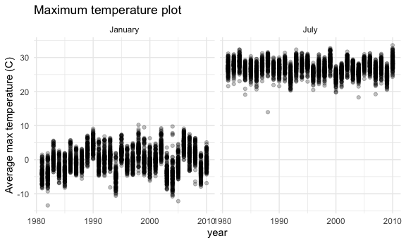
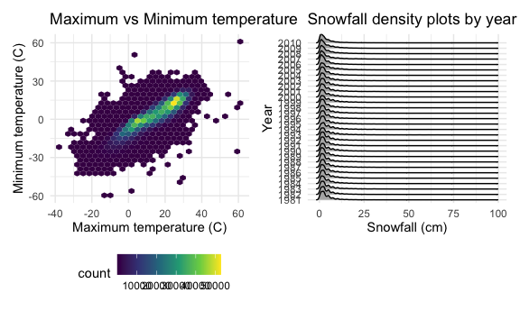
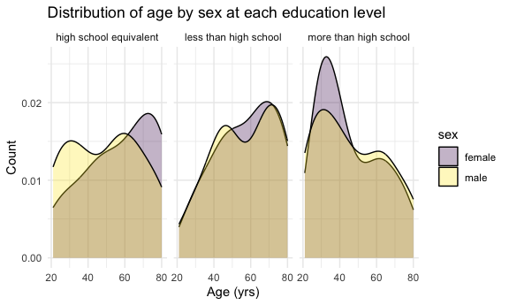
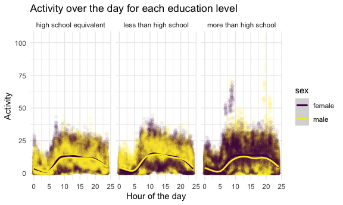
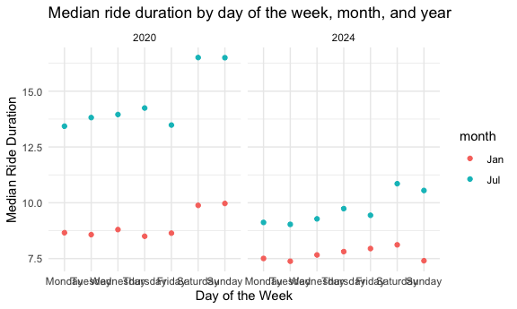
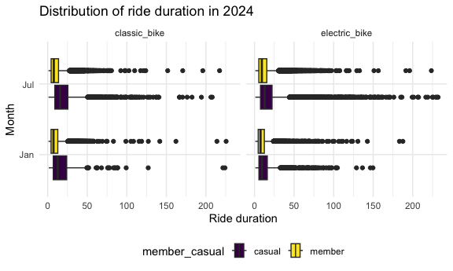

p8105_hw3_cc5423
================
Christina Chen
2026-10-14

### Initial settings + load packages:

``` r
library(tidyverse)
library(ggridges)
library(patchwork)
library(p8105.datasets)

knitr::opts_chunk$set(
  fig.width = 6,
  fig.asp = .6,
  out.width = "90%"
)

theme_set(theme_minimal() + theme(legend.position = "bottom"))

options(
  ggplot2.continuous.colour = "viridis",
  ggplot2.continuous.fill = "viridis"
)

scale_colour_discrete = scale_color_viridis_d
scale_fill_discrete = scale_fill_viridis_d
```

# Problem 1

Loading dataset:

``` r
data("ny_noaa")
```

Data cleaning:

``` r
ny_noaa_df =
  ny_noaa |> 
  mutate(month = lubridate::month(date), year = lubridate::year(date), day = lubridate::day(date),
         prcp = prcp/100, snow = snow/10, snwd = snwd/10, 
         tmax = as.numeric(tmax), tmin = as.numeric(tmin),
         tmax = tmax/10, tmin = tmin/10)
```

- Separate `date` variable into `month`, `day`, `year` variables
- Converting `prcp`, `snow`, and `snwd` into centimeters
- Converting `tmax` and `tmin` from character to numeric
- Converting `tmax` and `tmin` from tenth of degrees C into degrees C

This dataset has 2595176 observations and 10 variables once dates are
parsed out into month, day, and year separately. It is describing
precipitation and temperature across several weather stations and dates
across 30 years. There are 3387623 missing values across the whole
dataset, which is quite a bit.

For snowfall, what are the most commonly observed values?

``` r
ny_noaa_df |> 
  count(snow, sort = TRUE) |> 
  head()
```

    ## # A tibble: 6 × 2
    ##    snow       n
    ##   <dbl>   <int>
    ## 1   0   2008508
    ## 2  NA    381221
    ## 3   2.5   31022
    ## 4   1.3   23095
    ## 5   5.1   18274
    ## 6   7.6   10173

The most commonly observed values are 0 cm (since most days of the year
do not have snow), followed by missing values, then 2.5 cm.

Two-panel plot showing average max temperature in January and in July:

``` r
ny_noaa_df |> 
  filter(month == 1 | month == 7) |> 
  mutate(month = recode(month, `1` = "January", `7` = "July")) |> 
  group_by(id, month, year) |> 
  summarize(mean_tmax = mean(tmax, na.rm = TRUE)) |> 
  ggplot(aes(x = year, y = mean_tmax)) +
  geom_point(alpha = .25) +
  facet_grid(. ~ month) +
  labs(
    title = "Maximum temperature plot",
    x = "year",
    y = "Average max temperature (C)"
  )
```

    ## `summarise()` has regrouped the output.
    ## ℹ Summaries were computed grouped by id, month, and year.
    ## ℹ Output is grouped by id and month.
    ## ℹ Use `summarise(.groups = "drop_last")` to silence this message.
    ## ℹ Use `summarise(.by = c(id, month, year))` for per-operation grouping
    ##   (`?dplyr::dplyr_by`) instead.

    ## Warning: Removed 5970 rows containing missing values or values outside the scale range
    ## (`geom_point()`).


The average maximum temperature is much higher in July (around 25-30
degrees C) compared to January (around -10 to 10 degrees C) across all
years in our sample.

Two-panel plot showing the following:

- 1.  tmax vs tmin for the full dataset:
- 2.  distribution of snowfall values greater than 0 and less than 100
      separately by year:

``` r
tmax_tmin_p =
  ny_noaa_df |> 
  ggplot(aes(x = tmax, y = tmin)) +
  geom_hex() +
  labs(
    title = "Maximum vs Minimum temperature",
    x = "Maximum temperature (C)",
    y = "Minimum temperature (C)"
  )

snow_p =
  ny_noaa_df |> 
  filter(0 < snow & snow < 100) |> 
  mutate(year = as.factor(year)) |> 
  ggplot(aes(x = snow, y = year)) +
  geom_density_ridges() +
  labs(
    title = "Snowfall density plots by year",
    x = "Snowfall (cm)",
    y = "Year"
  )

tmax_tmin_p + snow_p
```

    ## Warning: Removed 1136276 rows containing non-finite outside the scale range
    ## (`stat_binhex()`).

    ## Picking joint bandwidth of 0.622



# Problem 2

Read in datasets:

``` r
demo_df =
  read_csv("data/nhanes_covar.csv", skip = 4, na = c("","NA",".")) |> 
  janitor::clean_names() |> 
  mutate(sex = recode(sex, `1` = "male", `2` = "female"),
         education = as.factor(recode(education, `1` = "less than high school", `2` = "high school equivalent", `3` = "more than high school"))) |> 
  filter(age >= 21) |> 
  drop_na()
```

    ## Rows: 250 Columns: 5
    ## ── Column specification ────────────────────────────────────────────────────────
    ## Delimiter: ","
    ## dbl (5): SEQN, sex, age, BMI, education
    ## 
    ## ℹ Use `spec()` to retrieve the full column specification for this data.
    ## ℹ Specify the column types or set `show_col_types = FALSE` to quiet this message.

``` r
accel_df =
  read_csv("data/nhanes_accel.csv", na = c("","NA",".")) |> 
  janitor::clean_names()
```

    ## Rows: 250 Columns: 1441
    ## ── Column specification ────────────────────────────────────────────────────────
    ## Delimiter: ","
    ## dbl (1441): SEQN, min1, min2, min3, min4, min5, min6, min7, min8, min9, min1...
    ## 
    ## ℹ Use `spec()` to retrieve the full column specification for this data.
    ## ℹ Specify the column types or set `show_col_types = FALSE` to quiet this message.

``` r
final_accel_df = 
  left_join(demo_df, accel_df, by = "seqn")
```

- include all originally observed variables
- exclude participants less than 21 years of age
- exclude those with missing demographic data
- encode data with reasonable variable classes: sex is now male and
  female, education is a factor variable with less than hs, hs
  equivalent, and more than hs as different categories

Producing a reader-friendly table for the number of men and women in
each education category:

``` r
final_accel_df |> 
  group_by(sex, education) |> 
  summarize(n = n()) |> 
  knitr::kable()
```

    ## `summarise()` has regrouped the output.
    ## ℹ Summaries were computed grouped by sex and education.
    ## ℹ Output is grouped by sex.
    ## ℹ Use `summarise(.groups = "drop_last")` to silence this message.
    ## ℹ Use `summarise(.by = c(sex, education))` for per-operation grouping
    ##   (`?dplyr::dplyr_by`) instead.

| sex    | education              |   n |
|:-------|:-----------------------|----:|
| female | high school equivalent |  23 |
| female | less than high school  |  28 |
| female | more than high school  |  59 |
| male   | high school equivalent |  35 |
| male   | less than high school  |  27 |
| male   | more than high school  |  56 |

The majority of women have more than a high school degree at (n = 59).
Similarly, the majority of men have more than a high school degree at (n
= 54).

Visualizing the distribution of age of men and women in each education
category:

``` r
final_accel_df |> 
  group_by(sex, education) |> 
  ggplot(aes(x = age, fill = sex)) +
  geom_density(alpha = .3) +
  facet_grid (. ~ education) +
  labs(
    title = "Distribution of age by sex at each education level",
    x = "Age (yrs)",
    y = "Count"
  ) +
  theme_minimal()
```



More younger women than younger men have more than a high school degree,
though it approximately evens out as they age. The distribution of age
for those with less than a high school degree is similar across sex.
Fewer younger women have a high school equivalent degree compared to
younger men. However, more older women have a high school equivalent
degree compared to older men.

``` r
final_accel_df |> 
  mutate(total = rowSums(across(min1:min1440))) |> 
  ggplot(aes(x = age, y = total, color = sex)) +
  geom_smooth(se = FALSE) +
  geom_point(alpha = .3) +
  facet_grid (. ~ education) +
  labs(
    title = "Total activity by age and sex, stratified by education level",
    x = "Age (yrs)",
    y = "Total activity in a day"
  ) +
  theme_minimal()
```

    ## `geom_smooth()` using method = 'loess' and formula = 'y ~ x'


As age increases, the total activity in a day generally decreases across
all education levels. Additionally, the difference between men and
women’s total activity evens out at the oldest ages in our sample. For
women with a high school equivalent degree, the peak activity occurs
around 40 years of age. The demographic with the highest total activity
in a day is women with less than a high school degree in their mid-20s.

Three-panel plot showing the 24-hr activity time courses for each
education level:

``` r
final_accel_df |> 
  pivot_longer(min1:min1440, names_to = "minute", names_prefix = "min", values_to = "activity") |> 
  mutate(minute = as.numeric(minute), hour = minute/60) |> 
  ggplot(aes(x = hour, y = activity, color = sex)) +
  facet_grid (. ~ education) +
  geom_point(alpha = 0.05) +
  geom_smooth() +
  labs(
    title = "Activity over the day for each education level",
    x = "Hour of the day",
    y = "Activity"
  ) +
  theme_minimal()
```

    ## `geom_smooth()` using method = 'gam' and formula = 'y ~ s(x, bs = "cs")'



Those with a higher education level have several outliers of peak
activity level at a couple points in the day (around 8:00 am for women
and around 8:00 pm for men) as opposed to the other education levels.
However, across all education levels, activity is usually lowest in the
beginning of the day until 5:00 am, where it increases dramatically and
remains somewhat stable from 10:00 am to around 6:00 pm. The activity
throughout the day is also very similar in shape for both men and women
in each of the education levels.

# Problem 3

Reading in and combining files:

``` r
jan_2020_df =
  read_csv("data/citibike/Jan 2020 Citi.csv", na = c("","NA",".")) |> 
  mutate(month = "Jan", year = 2020)
```

    ## Rows: 12420 Columns: 7
    ## ── Column specification ────────────────────────────────────────────────────────
    ## Delimiter: ","
    ## chr (6): ride_id, rideable_type, weekdays, start_station_name, end_station_n...
    ## dbl (1): duration
    ## 
    ## ℹ Use `spec()` to retrieve the full column specification for this data.
    ## ℹ Specify the column types or set `show_col_types = FALSE` to quiet this message.

``` r
jan_2024_df = 
  read_csv("data/citibike/Jan 2024 Citi.csv", na = c("","NA",".")) |> 
  mutate(month = "Jan", year = 2024)
```

    ## Rows: 18861 Columns: 7
    ## ── Column specification ────────────────────────────────────────────────────────
    ## Delimiter: ","
    ## chr (6): ride_id, rideable_type, weekdays, start_station_name, end_station_n...
    ## dbl (1): duration
    ## 
    ## ℹ Use `spec()` to retrieve the full column specification for this data.
    ## ℹ Specify the column types or set `show_col_types = FALSE` to quiet this message.

``` r
jul_2020_df =
  read_csv("data/citibike/July 2020 Citi.csv", na = c("","NA",".")) |> 
  mutate(month = "Jul", year = 2020)
```

    ## Rows: 21048 Columns: 7
    ## ── Column specification ────────────────────────────────────────────────────────
    ## Delimiter: ","
    ## chr (6): ride_id, rideable_type, weekdays, start_station_name, end_station_n...
    ## dbl (1): duration
    ## 
    ## ℹ Use `spec()` to retrieve the full column specification for this data.
    ## ℹ Specify the column types or set `show_col_types = FALSE` to quiet this message.

``` r
jul_2024_df = 
  read_csv("data/citibike/July 2024 Citi.csv", na = c("","NA",".")) |> 
  mutate(month = "Jul", year = 2024)
```

    ## Rows: 47156 Columns: 7
    ## ── Column specification ────────────────────────────────────────────────────────
    ## Delimiter: ","
    ## chr (6): ride_id, rideable_type, weekdays, start_station_name, end_station_n...
    ## dbl (1): duration
    ## 
    ## ℹ Use `spec()` to retrieve the full column specification for this data.
    ## ℹ Specify the column types or set `show_col_types = FALSE` to quiet this message.

``` r
all_df =
  bind_rows(jan_2020_df, jan_2024_df, jul_2020_df, jul_2024_df)
```

- all column names are already clean
- added in month and year to label observations before combining
- combined all observations into one dataset using `bind_rows`

Producing a reader-friendly table showing the total number of rides in
each combination of year and month separating casual riders and Citi
Bike members:

``` r
all_df |> 
  group_by(member_casual, month, year) |> 
  summarize(N = n()) |> 
  knitr::kable()
```

    ## `summarise()` has regrouped the output.
    ## ℹ Summaries were computed grouped by member_casual, month, and year.
    ## ℹ Output is grouped by member_casual and month.
    ## ℹ Use `summarise(.groups = "drop_last")` to silence this message.
    ## ℹ Use `summarise(.by = c(member_casual, month, year))` for per-operation
    ##   grouping (`?dplyr::dplyr_by`) instead.

| member_casual | month | year |     N |
|:--------------|:------|-----:|------:|
| casual        | Jan   | 2020 |   984 |
| casual        | Jan   | 2024 |  2108 |
| casual        | Jul   | 2020 |  5637 |
| casual        | Jul   | 2024 | 10894 |
| member        | Jan   | 2020 | 11436 |
| member        | Jan   | 2024 | 16753 |
| member        | Jul   | 2020 | 15411 |
| member        | Jul   | 2024 | 36262 |

The fewest rides for casual riders happened in January 2024 (n = 6708),
and the most rides for casual riders happened in July 2020 (n = 20113).
In general, for casual riders, more rides happen in July than in
January. The fewest rides for Citi Bike members happened in January 2020
(n = 3), and the most rides for casual riders happened in July 2024 (n =
30858). In general, for Citi Bike members, fewer rides happened in 2020
as opposed to 2024.

Table showing the 5 most popular starting stations for July 2024:

``` r
all_df |>
  filter(month == "Jul", year == 2024) |> 
  group_by(start_station_name) |> 
  summarize(N = n()) |> 
  mutate(popularity_rank = min_rank(desc(N))) |> 
  arrange(popularity_rank) |> 
  slice_head(n = 5) |> 
  relocate(popularity_rank) |> 
  knitr::kable()
```

| popularity_rank | start_station_name       |   N |
|----------------:|:-------------------------|----:|
|               1 | Pier 61 at Chelsea Piers | 163 |
|               2 | University Pl & E 14 St  | 155 |
|               3 | W 21 St & 6 Ave          | 152 |
|               4 | West St & Chambers St    | 150 |
|               5 | W 31 St & 7 Ave          | 146 |

The most popular station in July 2024 was Pier 61 at Chelsea Piers, with
163 rides originating from this station. The second most popular station
was University Pl and E 14 St, followed by W 21 St and 6 Ave. The first
five most popular starting stations all look to be in mid-to-lower
Manhattan.

Plot to investigate the effects of day of the week, month, and year on
median ride duration, swapping to default color palette since yellow
dots are not clear against the white background:

``` r
jan_df =
  all_df |> 
    group_by(weekdays, month, year) |> 
    summarize(med_dur = median(duration)) |> 
    filter(month == "Jan")
```

    ## `summarise()` has regrouped the output.
    ## ℹ Summaries were computed grouped by weekdays, month, and year.
    ## ℹ Output is grouped by weekdays and month.
    ## ℹ Use `summarise(.groups = "drop_last")` to silence this message.
    ## ℹ Use `summarise(.by = c(weekdays, month, year))` for per-operation grouping
    ##   (`?dplyr::dplyr_by`) instead.

``` r
jul_df =
  all_df |> 
    group_by(weekdays, month, year) |> 
    summarize(med_dur = median(duration)) |> 
    filter(month == "Jul")
```

    ## `summarise()` has regrouped the output.
    ## ℹ Summaries were computed grouped by weekdays, month, and year.
    ## ℹ Output is grouped by weekdays and month.
    ## ℹ Use `summarise(.groups = "drop_last")` to silence this message.
    ## ℹ Use `summarise(.by = c(weekdays, month, year))` for per-operation grouping
    ##   (`?dplyr::dplyr_by`) instead.

``` r
ggplot(data = jan_df, aes(x = weekdays, y = med_dur, color = month)) +
  geom_point() +
  geom_point(data = jul_df) +
  facet_grid (. ~ year) +
  labs(
    title = "Median ride duration by day of the week, month, and year",
    x = "Day of the Week",
    y = "Median Ride Duration"
  ) +
  theme_minimal() +
  scale_color_discrete()
```


People generally have a longer median ride duration on the weekends
(Saturday and Sunday) compared to the weekdays. Additionally, The median
ride duration is higher in July compared to January in both 2020 and
2024. The median ride duration for both months (January and July) in
2024 are lower than the respective median ride durations for both months
in 2020.

For data in 2024, figure that shows the impact of month, membership
status, and bike type on the distribution of ride duration:

``` r
all_df |> 
  filter(year == 2024) |> 
  group_by(month, member_casual, rideable_type) |> 
  ggplot() +
  geom_boxplot(aes(x = duration, y = month, fill = member_casual)) +
  facet_grid(. ~ rideable_type) +
  labs(
    title = "Distribution of ride duration in 2024",
    x = "Ride duration",
    y = "Month"
  )
```


The distribution of ride duration in 2024 is right skewed overall, with
several outliers in the higher duration ranges. The mean ride duration
among members are usually lower than the mean ride duration among casual
riders. The 75th percentile ride duration across all months, bike types,
and members lie somewhere between 10 and 25 minutes. More outliers of
extremely long ride durations happen during July compared to January, as
well as with electric bikes compared to classic bikes.
