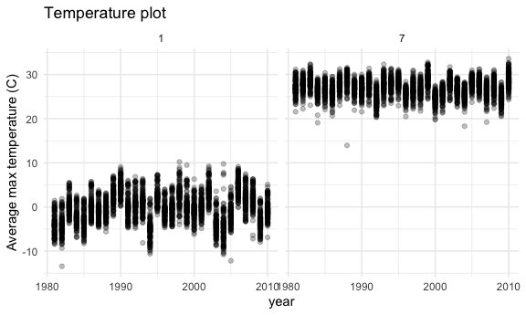
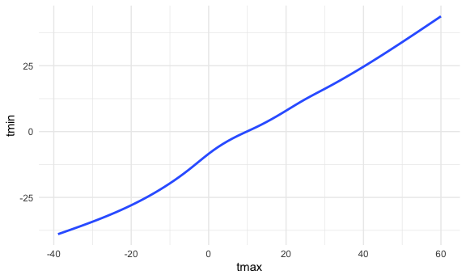
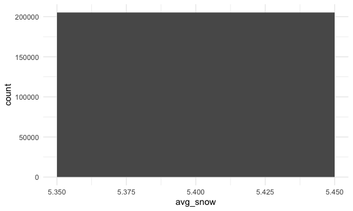

p8105_hw3_cc5423
================
Christina Chen
2026-10-14

### Initial settings + load packages:

``` r
library(tidyverse)
library(p8105.datasets)

knitr::opts_chunk$set(
  fig.width = 6,
  fig.asp = .6,
  out.width = "90%"
)

theme_set(theme_minimal() + theme(legend.position = "bottom"))

options(
  ggplot2.continuous.colour = "viridis",
  ggplot2.continuous.fill = "viridis"
)

scale_colour_discrete = scale_color_viridis_d
scale_fill_discrete = scale_fill_viridis_d
```

# Problem 1

Loading dataset:

``` r
data("ny_noaa")
```

Data cleaning:

``` r
ny_noaa_df =
  ny_noaa |> 
  mutate(month = lubridate::month(date), year = lubridate::year(date), day = lubridate::day(date),
         prcp = prcp/100, snow = snow/10, snwd = snwd/10, 
         tmax = as.numeric(tmax), tmin = as.numeric(tmin),
         tmax = tmax/10, tmin = tmin/10)
```

- Separate `date` variable into `month`, `day`, `year` variables
- Converting `prcp`, `snow`, and `snwd` into centimeters
- Converting `tmax` and `tmin` from character to numeric
- Converting `tmax` and `tmin` from tenth of degrees C into degrees C

This dataset has 2595176 observations and 10 variables once dates are
parsed out into month, day, and year separately. It is describing
precipitation and temperature across several weather stations and dates
across 30 years. There are 3387623 missing values across the whole
dataset, which is quite a bit.

For snowfall, what are the most commonly observed values?

``` r
ny_noaa_df |> 
  group_by(snow) |> 
  summarize(n_obs = n())
```

    ## # A tibble: 282 × 2
    ##     snow   n_obs
    ##    <dbl>   <int>
    ##  1  -1.3       1
    ##  2   0   2008508
    ##  3   0.3    8790
    ##  4   0.5    9748
    ##  5   0.8    9962
    ##  6   1      5106
    ##  7   1.3   23095
    ##  8   1.5    3672
    ##  9   1.8    3226
    ## 10   2      4797
    ## # ℹ 272 more rows

The most commonly observed values are

Two-panel plot showing average max temperature in January and in July:

``` r
ny_noaa_df |> 
  filter(month == 1 | month == 7) |> 
  group_by(id, month, year) |> 
  summarize(mean_tmax = mean(tmax, na.rm = TRUE)) |> 
  ggplot(aes(x = year, y = mean_tmax)) +
  geom_point(alpha = .25) +
  facet_grid(. ~ month) +
  labs(
    title = "Temperature plot",
    x = "year",
    y = "Average max temperature (C)"
  )
```

    ## `summarise()` has regrouped the output.
    ## ℹ Summaries were computed grouped by id, month, and year.
    ## ℹ Output is grouped by id and month.
    ## ℹ Use `summarise(.groups = "drop_last")` to silence this message.
    ## ℹ Use `summarise(.by = c(id, month, year))` for per-operation grouping
    ##   (`?dplyr::dplyr_by`) instead.

    ## Warning: Removed 5970 rows containing missing values or values outside the scale range
    ## (`geom_point()`).



Two-panel plot showing tmax vs tmin for the full dataset:

``` r
ny_noaa_df |> 
  ggplot(aes(x = tmax, y = tmin)) +
  geom_smooth(se = FALSE)
```

    ## `geom_smooth()` using method = 'gam' and formula = 'y ~ s(x, bs = "cs")'

    ## Warning: Removed 1136276 rows containing non-finite outside the scale range
    ## (`stat_smooth()`).



Plot showing distribution of snowfall values greater than 0 and less
than 100 separately by year:

``` r
ny_noaa_df |> 
  filter(0 < snow & snow < 100) |> 
  mutate(avg_snow = mean(snow, na.rm = TRUE)) |> 
  ggplot(aes(x = avg_snow)) +
  geom_histogram()
```

    ## `stat_bin()` using `bins = 30`. Pick better value `binwidth`.


